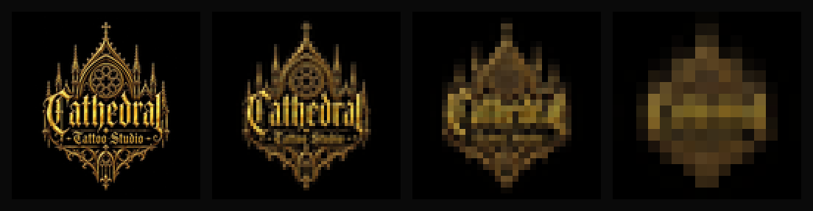

# Logo Source Analysis — Cathedral Tattoo Studio

*Run 2026-09-05 on `01-Brand-Assets/cathedral-tattoo-studio-denham-springs-gold-gothic-logo-1242px-largest-available.jpg`
(1242×1242) and the taller crop `...-logo-lockup-on-black.jpg` (1122×1402).*

## Conclusion first

**There is almost certainly no vector of this logo, and asking for one is unlikely to
produce it. The mark cannot be traced into a usable one either. It has to be
redrawn.**

This does not mean the mark is bad. It is the most distinctive identity in the parish
and the brand strategy rests on it (`brand/positioning.md`). It means the artwork we
have is a **picture of a logo**, not a logo — and the difference only shows up when
you try to use it.

## What was measured

| Test | Result | What it means |
|---|---|---|
| Symmetry: image vs. its own mirror | **70.2% of all ink pixels differ by >30/255** | The mark *reads* symmetrical but is not. Nothing is constructed or duplicated; both sides were drawn independently |
| Unique RGB values | **129,764** | A logo is normally 1–3 flat colours. This is a continuous-tone metallic render |
| Ink coverage | 14.0% of canvas | Consistent with the palette sampling already in `DESIGN.md` |
| Two "Cathedral" lockup files | Same artwork, different crop | One mark, not two competing generations. Good news |

## Reduction test

*Reduced to 128 / 64 / 32 / 16px, then magnified to show what survives.*

- **128px** — holds, wordmark legible.
- **64px** — "Cathedral" is mush; the spires merge.
- **32px** (favicon, GBP thumbnail) — an unreadable gold smear.
- **16px** (browser tab) — a blob.

**A favicon cannot be cut from this file at any quality.** Neither can a stamp,
embroidery, an aftercare sticker, or a social avatar at display size.

## Why there is no vector

The two measurements point the same way. A vector-built mark is almost always
constructed: one spire drawn once and mirrored, tracery repeated on a grid, flat spot
colours. This artwork has independently drawn sides and 130,000 colours in a gradient
metallic finish with cast highlights.

That is the signature of either **generative AI** or **a raster illustration built in
Photoshop/Procreate with layer effects**. ⚠️ **We cannot tell which from the file
alone, and it does not matter for the plan** — both produce exactly the same
situation: a flat raster with no paths behind it, and no vector to hand over.

The practical read: whoever supplied this gave Roger a JPEG or PNG because that is all
that ever existed.

## What this changes

**1. R-01 stops being a blocker we wait on.** Keep asking, because a layered PSD or
Procreate file would still help a redraw. But plan for the answer being "I just have
the picture."

**2. Auto-tracing is the wrong move — do not do it.** Vector Magic, Illustrator Image
Trace or Adobe's vectoriser on this file would produce thousands of paths chasing
gradient banding and filigree. The output would be enormous, uneditable, still
asymmetric, and *still illegible at 32px*, because tracing does not fix the real
problem. The problem is not the file format. **It is that the mark carries far more
detail than a logo can carry.** ⚠️ `DESIGN.md` currently anticipates "the Vector Magic
trace" as a path; that line should be retired.

**3. The identity brief becomes a redraw brief.** See `brand/identity.md` §02.

**4. ⚠️ Ownership of the mark is worth a question.** If the artwork was generated by
AI, US Copyright Office guidance is that material lacking human authorship is not
registrable — which would mean Cathedral may be unable to register or defend the mark,
and could not stop a competitor using a near-identical one. **This is a flag, not
legal advice, and not a reason to stop using it.** Add to the client conversation: who
made this, with what tool, and is there a written agreement transferring rights?

## Recommended path: a tiered redraw

Keep the concept and the equity. Rebuild it so it works. The concept is strong: gothic
facade, rose window, cross, blackletter wordmark, gold on black. None of that changes.

| Tier | Use | Direction |
|---|---|---|
| **Full lockup** | Website header, print, signage, hero | Faithful redraw. True symmetry, flat/two-tone gold with an optional gradient layer for large use. Keep the spires, rose window, cross and bottom tracery |
| **Simplified lockup** | Social header, letterhead, ~200–600px | Fewer spires, tracery simplified, wordmark weight increased |
| **Badge** | Avatars, stamps, embroidery, stickers, ~64–200px | Facade silhouette plus rose window. Wordmark dropped or reduced to "CTS" |
| **Glyph** | Favicon, app icon, ≤32px | **The rose window alone, or the cross.** This is a design decision, not a resize — see the reduction test |

**The redraw must also settle the asymmetry.** With 70% of ink differing side to side,
someone has to choose which spire arrangement is canonical, then mirror it. That is a
judgement call and it should be made deliberately rather than inherited from a render.

**Source to redraw from:** the taller `...-logo-lockup-on-black.jpg` (1122×1402). It
carries more of the outer spires than the square crop.

## Effort

A competent vector illustrator: roughly a day for the full lockup, plus half a day for
the three reductions. This is real design work, not a file conversion, and it is now
**the highest-value production task in the project** — it unblocks the favicon, OG
card, print, signage, merchandise, `brand-guidelines`, and true colour tokens sampled
from flat fills instead of gradient stops.

## Method note
Symmetry and colour measured with Pillow: greyscale, horizontal mirror, absolute
difference, ink threshold >40/255, difference threshold >30/255. Reduction test used
Lanczos downsampling and nearest-neighbour magnification so no detail was invented.
Both are reproducible from this repo.
